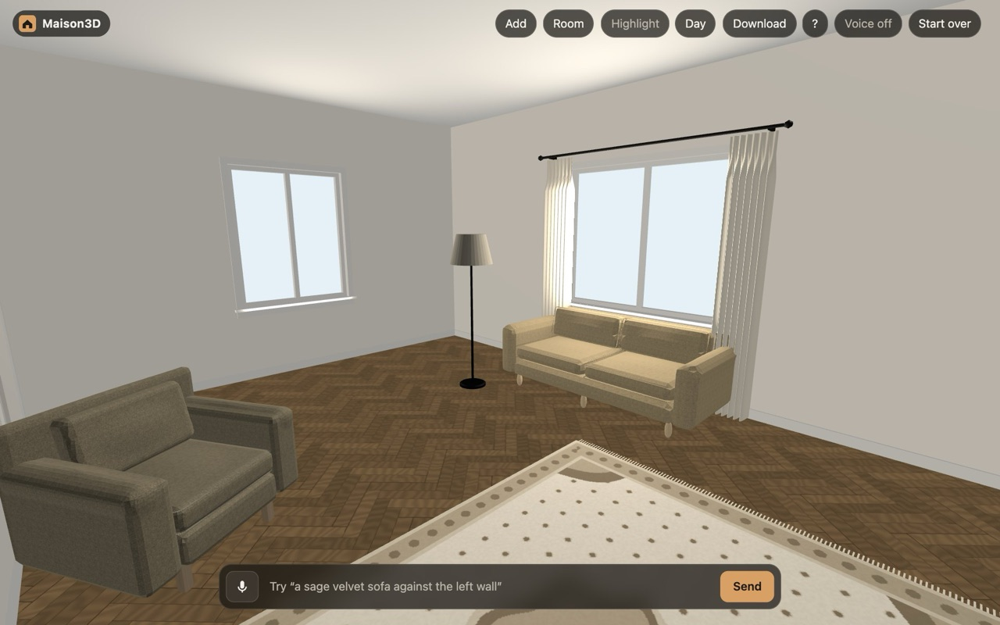
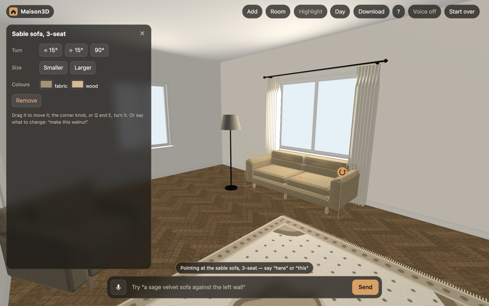
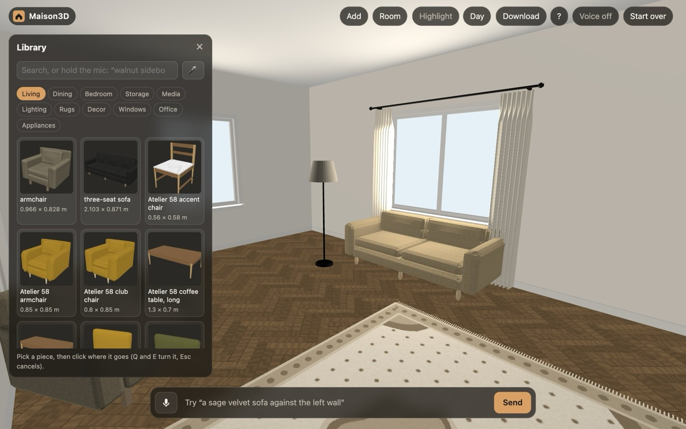
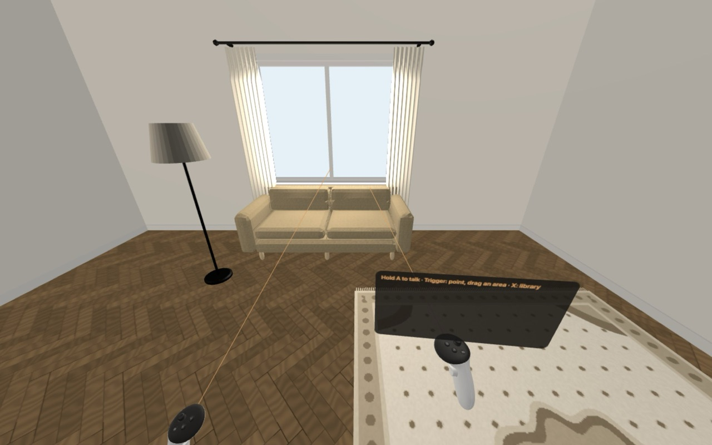

# Maison3D

Furnish a room by talking to it, at true size, in a browser or in VR on a Meta Quest. Meta's models design the room,
using a library of 736 pieces of furniture made with [mojulo](https://github.com/zombico/mojulo).

**[Try the live demo](https://maison3d.fly.dev)**: nothing to install.



## Run it locally

You need [Node.js](https://nodejs.org) 22 or newer. To talk to the designer, you also need a Meta Model API key
([docs](https://dev.meta.ai/docs)).

**1. Get the code.** The download is about 130 MB because it includes the 3D models.

```bash
git clone https://github.com/zombico/Maison3D.git
cd Maison3D
```

**2. Add your API key.** `.env` is ignored by git.

```bash
echo "META_API_KEY=your-key" > .env
```

**3. Start the server.** There's no install step, because the app has no npm dependencies.

```bash
npm start
```

**4. Open <http://localhost:8091>.**

Without a key you can still browse the library, place and move furniture by hand, and download the room. Typing or
talking to the designer needs the key.

## Try it

Type or hold the mic and say what you want. A whole room can take about 20 seconds, and a single piece a few:

- "Make this a calm Japandi living room"
- "A dining table for six with chairs around it on the left"
- "A slatted media console against the right wall with a 65 inch TV above it"
- "Herringbone floor and limewash walls"

Click something first to say "here" or "this". You can also do it by hand: **Add** opens the library, and clicking a
piece opens its controls.

| Select a piece to move, turn, resize or recolour it | Browse the library without using the model |
|---|---|
|  |  |

| In the browser | |
|---|---|
| Look around, move in | Drag, scroll |
| Talk | Hold the mic button or the space bar |
| Move a piece | Drag it |
| Turn a piece | Drag its corner knob, or press Q and E |
| Remove a piece | Delete |
| Mark an area ("a sofa that fits here") | Shift-drag over the floor or a wall |

When you're done, **Download** saves the room as a walkable page that opens in any browser (it needs internet to load its
3D library), or as a `.glb` model for Blender, Godot or three.js.

## In VR on a Quest

The easiest way is to open the [live demo](https://maison3d.fly.dev) in the Quest browser. To use your local server,
connect the headset by USB and forward the port, since the mic and VR need HTTPS or `localhost`:

```bash
adb reverse tcp:8091 tcp:8091
```

Then open <http://localhost:8091> in the Quest browser, allow the microphone, and press **Enter VR**.



| In VR | |
|---|---|
| Talk | Hold A or the grip |
| Walk and strafe | Left stick |
| Turn | Right stick |
| Point | Trigger |
| Mark an area | Pull the trigger and drag across a surface |
| Carry a piece | Hold the trigger on it (the stick turns it) |
| Open the library | X or Y |

The **Sticks** button, in the page header or on the VR library panel, switches to stepping and turning in clicks.

## Options

Set these in `.env` or in your shell:

| Variable | Default | What it does |
|---|---|---|
| `PORT` | `8091` | The port to serve on |
| `MAISON_MODEL` | `muse-spark-1.3` | The Meta model that designs the room |
| `MAISON_EFFORT` | `minimal` | The model's reasoning effort |
| `MAISON_PIPER`, `MAISON_PIPER_VOICE` | Not set | Paths to a [Piper](https://github.com/rhasspy/piper) binary and voice, for spoken replies |

Spoken replies use Piper if it's set, then macOS `say`, and then the browser's own voice.

**Running it like the demo:** this Docker image includes Piper and the demo's turn limits, and serves on port 8080.

```bash
docker build --platform linux/amd64 -t maison3d .
docker run --rm --platform linux/amd64 -p 8080:8080 -e META_API_KEY=your-key maison3d
```

**More materials and export formats:** `npm run mojulo:setup` installs mojulo. This lets you rebuild a piece's parts in
other materials and adds an export with a USDZ and a Godot project.

## Troubleshooting

| Problem | Fix |
|---|---|
| `no META_API_KEY` | Check that `.env` is in the repo's root folder, then restart the server |
| Port 8091 is already in use | Run `PORT=8092 npm start` and open that port |
| The microphone doesn't work | Use `localhost` or HTTPS, and allow the mic for the site |
| Rooms disappear | Rooms live in the server's memory, so they're cleared when it restarts. Download the ones you want to keep |

## What's in the repo

| Folder | Contents |
|---|---|
| `07-spike-native-furnish/` | The server, the web app (`web/`) and the native Quest app (`app/`) |
| `70-inventory/` | The furniture library and its models |
| `mojulo/` | The pinned mojulo version and an MCP server for making furniture |
| `docs/` | The documents listed below |

- [How it works](docs/how-it-works.md): the design tools, furniture library, room model and native Quest app
- [Deploying the demo](docs/deploy.md): hosting your own on Fly.io or Render
- [Packaging proposal](docs/packaging-proposal.md): the plan for a store-ready release
